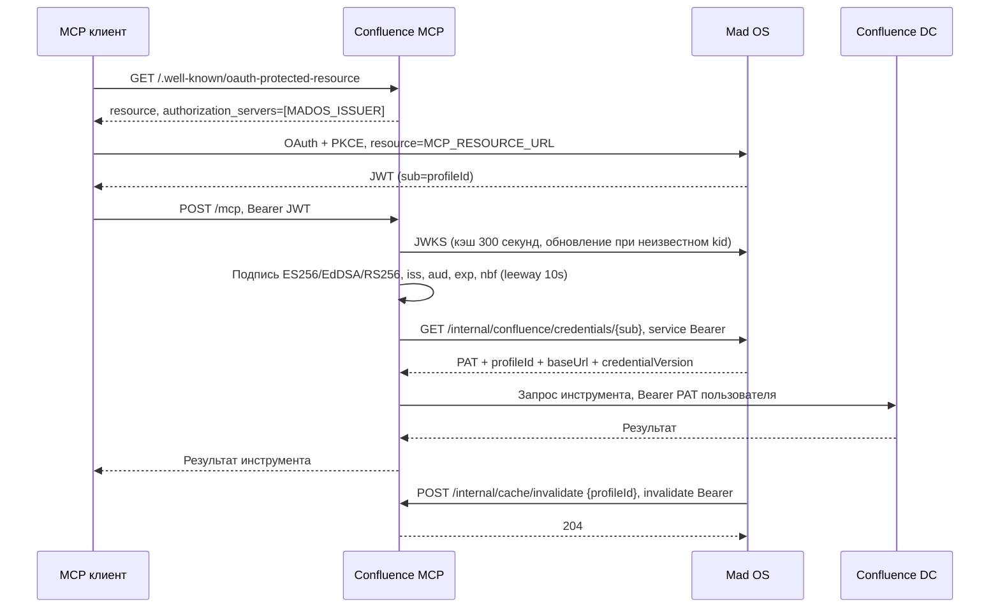

# Confluence MCP для Mad OS

Форк основан на upstream v0.24.6. Режим включается только через
`MADOS_AUTH_ENABLED=true`. Без него поведение upstream сохраняется.
Поддерживается Confluence Data Center; вызов Jira в этом режиме возвращает
явную ошибку. Используйте только Confluence в `ENABLED_TOOLS`.

## Настройки

| Переменная | Значение / назначение |
| --- | --- |
| `MADOS_AUTH_ENABLED` | `true` включает режим (по умолчанию выключен) |
| `MADOS_ISSUER` | Точный issuer Better-Auth, например `https://mados-api.mb-dev.ru/api/auth` |
| `MADOS_JWKS_URL` | Например `https://mados-api.mb-dev.ru/api/auth/jwks` |
| `MCP_RESOURCE_URL` | Публичный адрес ресурса, например `https://confluence-mcp.mb-dev.ru/mcp` |
| `MADOS_INTERNAL_URL` | В prod chart: `http://mad-os-api.mad-os.svc.cluster.local:3000` |
| `MADOS_SERVICE_TOKEN` | Секрет, совпадающий с `CONFLUENCE_MCP_SERVICE_TOKEN` Mad OS |
| `MADOS_PAT_CACHE_TTL_SECONDS` | TTL PAT, по умолчанию `3600`, положительное конечное число секунд |
| `MADOS_CONFLUENCE_SETTINGS_URL` | Обязательный URL страницы подключения PAT в Mad OS |
| `MCP_INVALIDATE_TOKEN` | Секрет, совпадающий с `CONFLUENCE_MCP_INVALIDATE_TOKEN` Mad OS; без него invalidation отключён (404) |
| `CONFLUENCE_URL` | Например `https://c.mb-dev.ru`; должен совпадать с `baseUrl` ответа Mad OS |
| `ALLOW_GLOBAL_CRED_FALLBACK` | Обязательно `false` или отсутствует |
| `CONFLUENCE_SSL_VERIFY` | Проверка сертификата Confluence (по умолчанию включена) |
| `CONFLUENCE_SPACES_FILTER`, `CONFLUENCE_TIMEOUT` | Сохраняются ограничения оператора upstream |

Не задавайте глобальные `CONFLUENCE_PERSONAL_TOKEN`, `CONFLUENCE_API_TOKEN`, их
`_COMMAND` варианты или глобальные OAuth credentials: запуск будет отклонён.
Секреты передавайте из Secret/окружения, никогда не помещайте в репозиторий.

Запуск: `uv run mcp-atlassian --transport streamable-http --stateless --port 9000`.
Этот режим предназначен для HTTP; без проверенного HTTP-контекста инструмент
не получает PAT. `IGNORE_HEADER_AUTH` не отключает проверку Mad OS.

## Поток запроса

Discovery доступен также по `/.well-known/oauth-protected-resource/mcp`.
Для другого resource path используется соответствующий суффикс. Отсутствующий
или неверный JWT даёт 401 с `WWW-Authenticate` и публичным URL metadata;
`invalid_token` добавляется, когда Authorization был передан.
`/healthz` остаётся публичным.

MCP не проксирует авторизацию и не регистрирует OAuth-клиентов: это делает Mad OS.
Mad OS должен публиковать RFC 8414 metadata и OIDC discovery в корне origin и
на пути issuer для совместимости клиентов. DCR public clients, PKCE S256,
allowlist redirect URI и resource/audience — ответственность Mad OS.

PAT хранится только в памяти, максимум 1024 профиля (LRU), TTL 3600s.
404/403 кэшируются максимум на 30s; сетевые ошибки, 401 и 5xx не кэшируются.
PAT не попадает в собственные логи/сообщения ошибок модуля. Проверяйте, что
внешние APM/HTTP debug middleware не записывают Authorization и тела ответов.
Заполнение кэша и invalidation сериализованы: завершённый invalidation не может
быть отменён старым параллельным fetch. Уже выполняющийся запрос не прерывается.
PAT не переносится в глобальный fetcher, request fetcher закрывается после ответа.

Для v1 нужна **одна реплика** MCP. Для нескольких реплик потребуется fan-out
invalidation на все pod (например через headless service). `/internal/` следует
исключить из публичного ingress, разрешив доступ только Mad OS внутри кластера.
Взаимные service/invalidation секреты независимы от пользовательских JWT.

Если PAT отсутствует: «Confluence не подключён. Подключите свой Personal Access
Token в Mad OS: …». Если профиль неактивен: «Ваш профиль в Mad OS не активен».
При сбое внутреннего API: «Mad OS недоступен, попробуйте позже».
Создание PAT в DC: `https://c.mb-dev.ru/plugins/personalaccesstokens/usertokens.action`.

В прочитанном checkout Mad OS route `/settings/confluence` пока отсутствует;
перед совместным запуском сторона Mad OS должна добавить страницу и передать
её действительный URL в `MADOS_CONFLUENCE_SETTINGS_URL`. Этот форк её не создаёт.

## Обновление upstream

1. Создайте рабочую ветку от ветки форка; добавьте remote upstream, если его нет.
2. Выполните `git fetch upstream --tags`, затем `git rebase <новый-tag>`.
3. Проверьте hook points с комментарием `# MadBrains: mados-auth` в
   `servers/main.py` (HTTP boundary, доступность инструментов, startup) и
   `servers/dependencies.py` (выбор fetcher). Основной код — `mados_auth/`.
4. Выполните `uv sync --frozen --all-extras --dev`, `uv run pytest`,
   `uv run pre-commit run --all-files` и HTTP smoke с режимом on/off.
5. Обновите upstream version в workflow и повторите JWT/изоляционные тесты.

## Выпуск образа

Workflow `MadBrains image` выполняется на push в `main`, тег
`mb-v0.24.6-mb.N` либо вручную. Сначала запускаются unit tests и полный upstream pre-commit (Ruff + mypy),
затем образ публикуется в `mb-registry.cr.cloud.ru/mad-os/confluence-mcp` с
тегами `0.24.6-mb.<run_number>` (или версией тега) и `sha-<полный-sha>`.
Секреты registry совпадают с Mad OS:
`CLOUDRU_REGISTRY_KEY_ID`, `CLOUDRU_REGISTRY_KEY_SECRET`.
Upstream Docker/PyPI publishing и устаревший pip-based lint отключены для
форков условием repository. В fork workflow проверки выполняются через uv на Python 3.10.
Проверки upstream, которым не нужны секреты, сохранены.

Локально: `docker build -t confluence-mcp:test .` (нужен Docker BuildKit/Buildx).
Smoke: запустить с тестовыми env, проверить metadata, `/healthz` и 401 для
`POST /mcp` без токена; после проверки остановить и удалить контейнер.
Публикация workflow не выполняет deploy. Деплой выполняется отдельным процессом.
